# Slowtown

Un launcher para Android que convierte el teléfono de todos los días en un
dumbphone que sigue siendo útil: llamadas, mensajes, WhatsApp, banco, mapas,
música y búsqueda. Lo demás queda cerrado, y aflojarlo cuesta a propósito.

Está hecho para un Galaxy S10e con Android 12, en Kotlin y Jetpack Compose.

## Qué hace

- **Inicio en texto:** la hora (una sola: la de la barra se esconde), el
  tiempo de pantalla del día, las apps que elegiste y tus hábitos, del tamaño
  que quieras. Deslizando para arriba,
  todas las apps, con carpetas, buscador y apps ocultas que sólo aparecen al
  buscarlas.
- **Slowtown activo:** con Device Owner y lock task sólo se abren las apps
  permitidas. No hay Recientes ni ajustes rápidos, e Inicio es siempre
  Slowtown. La configuración pide una contraseña larga.
- **Dos niveles:** el primero es lo que se cambia con la contraseña (las apps
  permitidas y las páginas que se suman). El segundo sólo cambia con una
  versión nueva, instalada por cable: las políticas de Chrome, con la lista de
  bloqueo por defecto de la Universidad Toulouse Capitole, y las apps que no se
  abren nunca.
- **Bedtime:** de noche sólo se abren el reloj y las alarmas (y las
  llamadas, SMS y emergencias). Para usar el teléfono, ráfagas de 5 minutos.
  Nunca corta una llamada, tampoco las de WhatsApp.
- **Notificaciones por oleadas:** las de las apps que elijas esperan y llegan
  todas juntas, en silencio, a ciertas horas, salvo las que traen una palabra
  de «pasan siempre». Con «sólo los grupos», de WhatsApp esperan los grupos y
  los chats de a dos llegan en el momento.
- **«Habilitar todo por 5 minutos»:** sin contraseña, hasta 2 veces cada 12
  horas, para actualizar apps.
- **Hábitos como los cuadraditos de GitHub:** hasta 4 de un catálogo de 14,
  cada uno con su dibujo y sus veces por semana. Se marcan desde Inicio, y un
  fuego cuenta las semanas seguidas con la meta cumplida.
- **Siempre hay una salida por cable:** `scripts/liberar.sh`.

## Descargar

La última versión está en
[Releases](https://github.com/mjlascar/Slowtown/releases/latest). Hace
falta Android 12 o más nuevo.

1. Desde el teléfono, bajá `Slowtown-X.Y.Z.apk` y abrilo.
2. Aceptá instalar apps de esa fuente: Android lo pregunta la primera vez.
3. Apretá Inicio y elegí Slowtown, o andá a Ajustes → Aplicaciones →
   Aplicaciones predeterminadas → Aplicación de inicio. Para volver al de
   antes, se elige otro en el mismo lugar.

Si Google Play Protect la frena («App blocked to protect your device»): en
algunos países Google no deja instalar desde el navegador las apps que leen
notificaciones, y Slowtown las lee para las oleadas. Por cable
(`adb install`) se instala igual. Si no, se apaga un momento Play Protect
(Play Store → tu perfil → Play Protect → ⚙ → «Escanear apps con Play
Protect»), se instala y se vuelve a prender.

Así es un launcher: Inicio en texto, hábitos, carpetas y apps ocultas. El
tiempo de pantalla y las notificaciones por oleadas piden un permiso que
Android da desde Ajustes: «Acceso a datos de uso» y «Acceso a
notificaciones».

Lo que cierra el teléfono de verdad (Device Owner: sólo las apps permitidas,
Bedtime y el nivel 2) se activa por cable, con una compu y
`scripts/provisionar.sh`, y exige sacar un rato las cuentas del teléfono. Ese
camino usa la variante de prueba, que la salida por cable siempre puede
sacar, y no la de las releases.

Todas las releases salen firmadas con el mismo certificado, de huella SHA-256
`3ef7e1d4a3e180864607d49a7c2ac38b0190d03b94f0c3e95d897e066bb25559` (también en `scripts/firma-releases.sha256`).

## Capturas

Del emulador (Android 12, sin cuentas), por eso las apps están en inglés.

| | | |
|:---:|:---:|:---:|
| 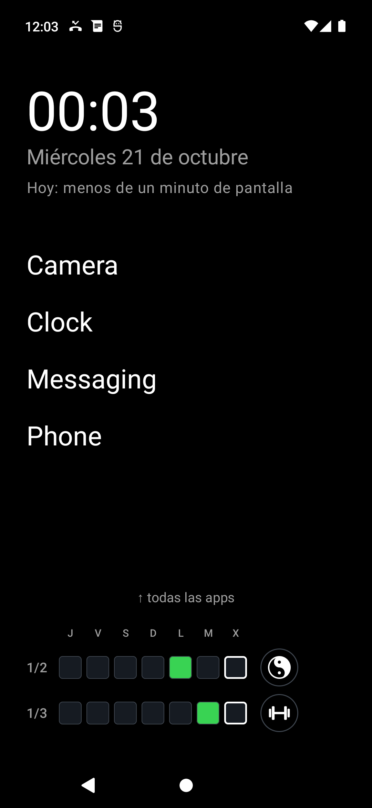 Inicio | 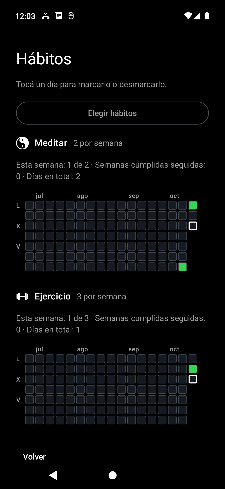 El resumen de hábitos | 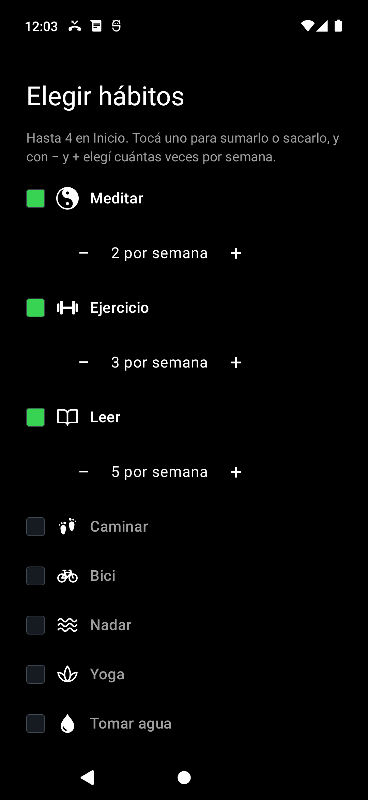 Elegir hábitos y sus veces por semana |
| 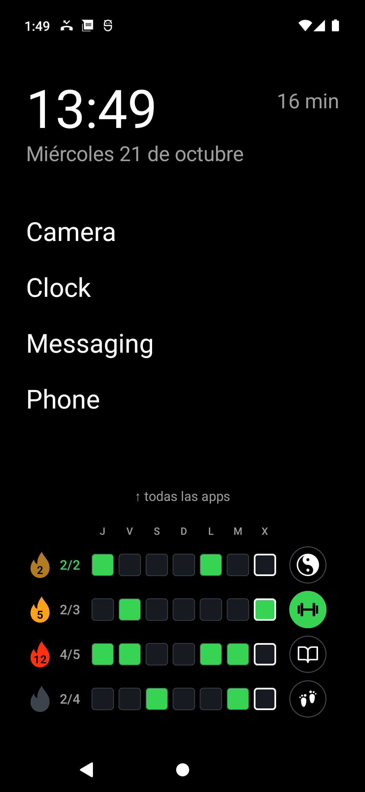 Inicio con más hábitos | 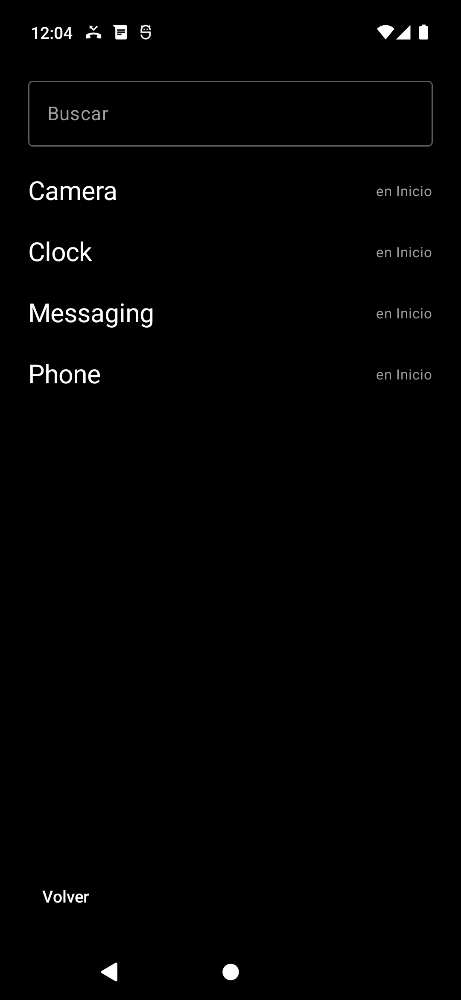 Todas las apps | 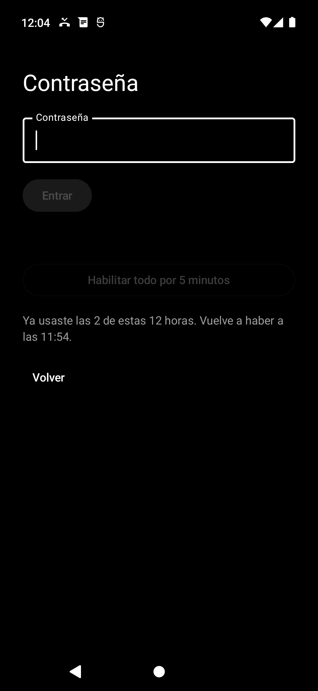 La contraseña y «Habilitar todo» |
| 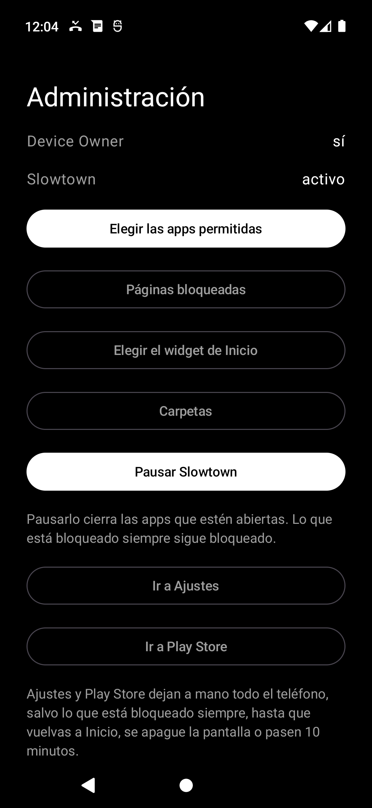 La administración | 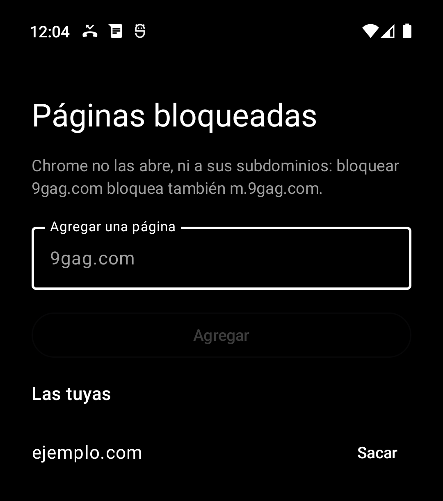 Páginas bloqueadas | 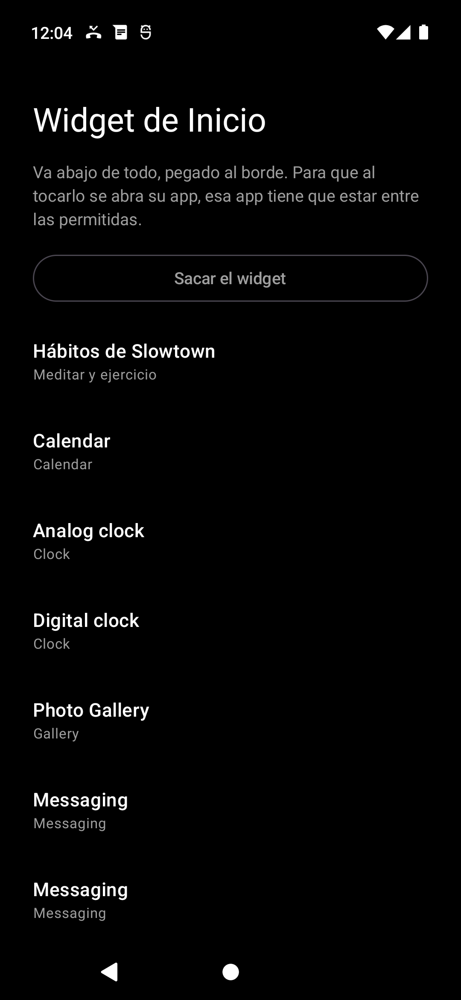 El widget de Inicio |
| 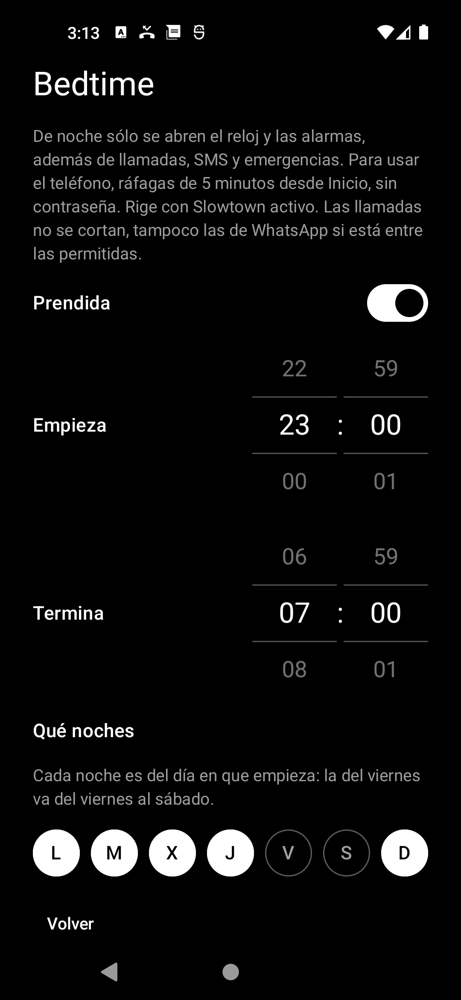 Bedtime | 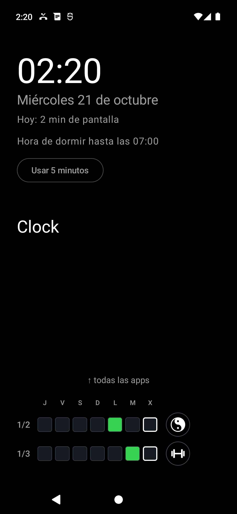 De noche: sólo el reloj | 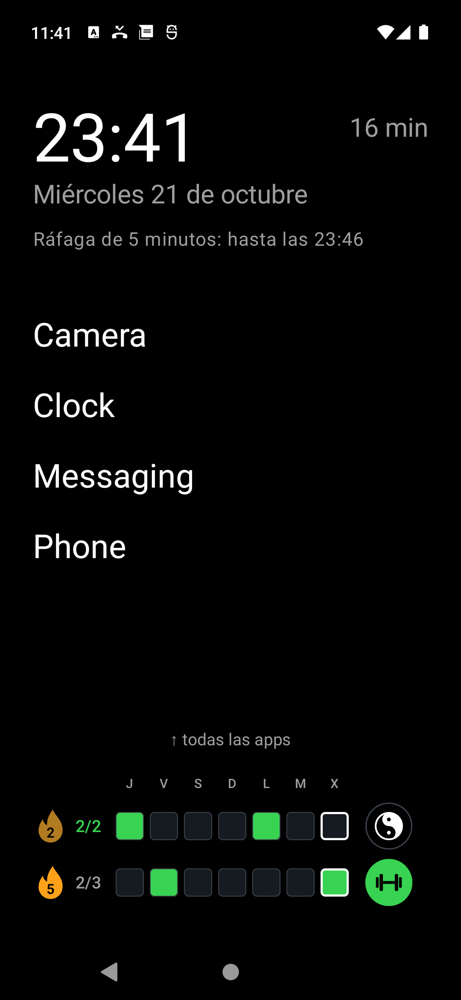 Una ráfaga de 5 minutos |
| 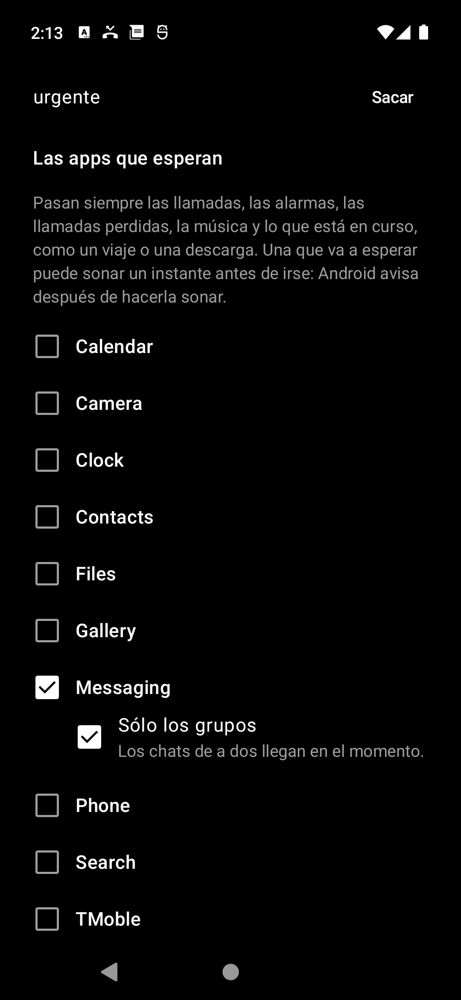 Notificaciones: sólo los grupos | | |

## Cómo se prueba

`./scripts/probar-emulador.sh --limpio` recorre todo en un emulador con
Android 12: instalar, activar, intentos de escape, llamada, SMS, los dos
niveles, hábitos, tiempo de pantalla, reinicio, cuelgues y la salida por
cable. Termina con código 1 si algo falla.

Cómo se arma, las reglas que no se rompen y por qué: [`CLAUDE.md`](CLAUDE.md).
Lo que se investigó antes de escribir código: [`docs/investigacion.md`](docs/investigacion.md).
